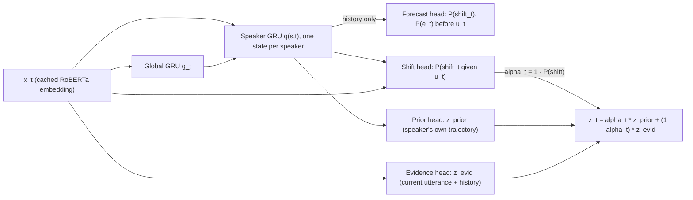

# EmotionShift: Recognizing, Anticipating and Explaining Emotional Turning Points in Conversation

*EE6405 Final Capstone — Project 2 proposal (revised)*

## 1. Motivation

Emotion recognition in conversation (ERC) is usually scored with one aggregate weighted-F1, and on that scale conversational context looks like a small win. On MELD, EmoBERTa goes from 63.46 with no context to 64.55 with past turns and 65.61 with past and future turns. The aggregate hides where the errors are. When results are split by emotion shift, the same class of models is 11–14 accuracy points worse on utterances where a speaker's emotion changes than on utterances where it stays the same (MELD: 60.0 vs 73.5 for BERT-ERC; 61.6 vs 73.1 for SDT).

Our pilot analysis (Section 9, reproducible from `pilot/`) shows why this matters:

- **On MELD, shifts are the majority, not the exception.** Of the test utterances that have a previous turn by the same speaker, 53.8% are shifts (1,003 shift, 861 stable, plus 746 first turns). On DailyDialog the rate is 18.0%. A model that is weak at shifts is weak on most of what makes a conversation dynamic.
- **Emotional inertia is a strong and cheap signal.** Copying the speaker's previous gold emotion gives 0.449 weighted-F1 on MELD test, against 0.313 for always predicting neutral. A context model can raise its aggregate score by learning that "emotions persist", which helps on stable turns and fails at exactly the turning points.
- **The trigger benchmark has a recency shortcut.** On MELD-FR (SemEval-2024 Task 10), labelling only the immediately preceding utterance as the trigger scores F1 = 0.684 on the test set. That is above the original task baseline (0.53) and close to the best submitted systems (0.76–0.79). Any claim that a model "explains" a flip has to beat this line.

So the question is not "does context help?" (it does, slightly) but:

> **Where does conversational context help, where does it hurt, and can a model that reasons explicitly about emotional inertia recognize, anticipate and explain emotional turning points?**

## 2. Research questions and pre-registered hypotheses

The hypotheses are fixed before any test-set run. Negative results are reported as such.

| RQ | Question | Hypothesis (falsifiable) |
|---|---|---|
| **RQ1 Diagnose** | Where do context gains come from? | **H1** Gains from past context concentrate on stable turns; on shift turns the gain is smaller or negative. **H2** A shuffled-context control (same number of turns from random other dialogues) recovers less than half of the real-context gain. |
| **RQ2 Fix** | Can explicit shift supervision close the gap? | **H3** The proposed ShiftAware model improves shift-subset weighted-F1 by at least 2 points over the best context baseline, without a significant drop on stable turns. |
| **RQ3 Anticipate** | Can a flip be forecast before the utterance is seen? | **H4** Forecasting from history alone beats a Markov prior (AUROC 0.663 on MELD, even when the prior is given gold previous labels), but stays well below detection that sees the utterance. |
| **RQ4 Explain** | Do model explanations agree with human-annotated triggers? | **H5** Occlusion attributions concentrate on the preceding utterance, so unsupervised explanations land near the 0.684 heuristic; a supervised trigger model is needed to beat it. |
| **RQ5 Generalize** | Does shift behavior transfer across domains with different volatility? | **H6** Models trained on MELD (54% shift rate) over-predict shifts on DailyDialog (18%); forecast calibration (ECE) degrades across domains even where ranking (AUROC) holds. |

## 3. Data

Three core datasets (MELD, MELD-FR, DailyDialog) cover sitcom and everyday dialogue; EmoWOZ adds task-oriented dialogue if time allows.

| Dataset | Domain | Size | Labels | Role |
|---|---|---|---|---|
| **MELD** | *Friends* scripts, multi-party (2.7 speakers per dialogue on average) | 1.4K dialogues, 13,708 utterances | Ekman-6 + neutral; sentiment | Main ERC, shift and forecasting benchmark |
| **MELD-FR** (SemEval-2024 Task 10, subtask C) | Same MELD dialogues; splits align with MELD | 5,428 flips, 7,238 trigger labels in the released files | Trigger / not trigger for each earlier utterance | Explanation benchmark (RQ4) |
| **DailyDialog** | Written everyday two-party dialogue | 13,118 dialogues, 102,979 utterances | Ekman-6 + "no emotion" (83% of utterances) | Second domain, low volatility |
| **EmoWOZ** | Task-oriented dialogue (MultiWOZ plus human–machine) | 11K+ dialogues, 83K+ labelled user turns | 7 OCC-based labels (e.g., dissatisfied, apologetic, satisfied) | Optional (Could tier): out-of-domain test for a customer-service setting, at valence level |

**Changes from the first draft**

- **EmotionPush is dropped.** It consists of private Facebook Messenger logs that were released on request for EmotionX 2018, so access within our timeline is uncertain. EmoWOZ replaces it as the out-of-domain set; it is public on Hugging Face (`hhu-dsml/emowoz`).
- **The label sets mostly agree.** MELD and DailyDialog already share the same seven labels (DailyDialog's *happiness* maps to joy and *no emotion* to neutral), so cross-dataset ERC needs no lossy mapping. Only EmoWOZ requires one: it maps cleanly to positive/neutral/negative valence, so every comparison involving EmoWOZ is reported at valence level. Surprise is kept as a separate "ambiguous" class, and MELD's own sentiment labels give the empirical mapping.

**Data hygiene**

- **DailyDialog leaks between train and test.** 105 of the 996 unique test dialogues appear verbatim in train, and 197 of 1,000 share their first two turns with a training dialogue (consistent with Wen et al., 2022). We report the official test set for comparability with published numbers and a de-duplicated test set as the headline.
- **The shift definition is verified against MELD-FR.** Our same-speaker shift counts (4,001 / 427 / 1,003 for train/dev/test) match the released MELD-FR flips (4,000 / 426 / 1,002) to within one per split. This becomes a unit test.
- **MELD-FR's train and test annotations differ.** The previous-utterance heuristic scores 0.565 F1 on train but 0.684 on test (triggers at distance 1 make up 49% vs 64%). Decision thresholds are therefore tuned on dev, not train.
- **No gold labels at inference.** History features always use predicted emotions. Baselines that read gold history are labelled "oracle" and are never headline numbers.

## 4. Task definitions

Dialogue turns are $u_1,\dots,u_T$ with speakers $s_t$ and emotions $e_t$; $p(t)$ is the same speaker's previous turn.

| Task | Input → output | Setting |
|---|---|---|
| **T1 ERC** | $u_{\le t}$ → $e_t$ | Causal (online) setting is primary; offline (past and future) setting only for comparison with the literature |
| **T2 Shift detection** | $u_{\le t}$ → $\mathbb{1}[e_t \ne e_{p(t)}]$ | Defined only when $p(t)$ exists. Reported *direct* (a shift head) and *derived* (from predicted labels) |
| **T3 Shift forecasting** | $u_{<t}$, plus who speaks next → shift at $t$ and a distribution over $e_t$ | Early warning, made before $u_t$ is observed |
| **T4 Trigger identification** | A flip at $t$ → which $u_{\le t}$ caused it | MELD-FR; attribution-based (no trigger labels) and supervised |

For stratified analysis, every shift is assigned one of five types (counts are for the MELD test set): **onset** (neutral → emotion, 355), **offset** (emotion → neutral, 340), **valence flip** (positive ↔ negative, 69), **within-negative** (e.g., anger → sadness, 81) and **surprise-involved** (158).

## 5. Models

### 5.1 Baseline ladder

Every baseline is re-run with the same splits, seeds and metrics.

| ID | Model | Purpose |
|---|---|---|
| B0 | Majority class; inertia (copy the speaker's previous *predicted* emotion); Markov transition prior | Floors that show how much of the task is "emotion persists" |
| B1 | TF-IDF + logistic regression / linear SVM (utterance only) | Traditional ML (course weeks 3–4) |
| B2 | BiGRU over GloVe tokens + dialogue-level GRU | Recurrent baseline (week 5) |
| B3 | RoBERTa-base fine-tuned, utterance only | Strong no-context transformer |
| B4 | RoBERTa-base with speaker names and past *k* turns, *k* ∈ {1, 3, 5, 10, all} (EmoBERTa-style input) | Context-aware transformer; the window sweep |
| B4+ | B4 at its best *k*, with class-weighted or focal loss | Fallback improvement (R3): a measured gain over B3 even if ShiftAware only ties B4 |
| B5 | Instruction-tuned open LLM (e.g., Llama-3.1-8B-Instruct or Qwen2.5-7B-Instruct), zero- and few-shot, same *k* | LLM comparison (weeks 9–10); open weights for reproducibility; Could tier, only if time allows |
| Ref. | Published MELD weighted-F1: DialogueGCN 58.10, DialogXL 62.41, COSMIC 65.21, EmoBERTa 64.55 (past only) / 65.61 (past + future) | External reference points. EmoBERTa uses RoBERTa-large; we use base, so we expect to land 1–3 points lower |

DistilBERT from the first draft is replaced by RoBERTa, the standard ERC backbone (used by EmoBERTa and COSMIC). DistilRoBERTa is kept as the efficiency variant behind the demo, which gives an accuracy–latency trade-off curve.

### 5.2 Proposed model: ShiftAware (speaker-state dynamics with an inertia gate)

Most experiments use a two-stage design so they run in minutes:

1. **Utterance encoder.** Fine-tune B4 once per seed and cache an embedding $x_t$ for every utterance.
2. **Dynamics module** over the cached embeddings. It is causal: it only reads earlier turns.



- The **global GRU** $g_t$ tracks the conversation. The **speaker GRU** keeps one state $q_{s}$ per speaker, updated only when that speaker talks (as in DialogueRNN).
- The **forecast head** reads only $[q_{s_t,p(t)}; g_{t-1}]$, so it can run before $u_t$ arrives (task T3).
- The **inertia gate** $\alpha_t = 1 - \hat P(\text{shift}_t)$ mixes a *prior* (what this speaker would feel if nothing changed) with *evidence* (the current utterance). When a shift is likely, the model trusts the utterance; otherwise it trusts the speaker's trajectory. $\alpha_t$ is a readable per-turn number that the interpretation work (Section 8) and the demo both use.
- **Loss:** $\mathcal{L} = \mathrm{CE}_w(e_t) + \lambda_1\,\mathrm{BCE}(\text{shift}_t) + \lambda_2\,[\mathrm{BCE}(\text{forecast shift}) + \mathrm{CE}(\text{forecast } e_t)]$. The emotion term uses class weights or focal loss for imbalance (fear and disgust are about 2–3% of MELD). $\lambda_1$ and $\lambda_2$ are tuned on dev.

**Relation to prior work.** Shift modules exist for *multimodal* ERC: Shapes of Emotions (Bansal et al.), CFN-ESA (Li et al., 2024) and, most closely, SCoPE (Kaplan & Wermter, 2026), which weighs speaker priors against multimodal evidence using shift prediction. ShiftAware differs in four ways: it is text-only and causal, it forecasts before the utterance arrives, it checks its explanations against human trigger labels, and it is tested across domains.

### 5.3 Trigger identification (RQ4)

- **Attribution, no trigger supervision.** Leave-one-utterance-out occlusion on B4 and ShiftAware: remove each earlier utterance and measure the drop in probability of the emotion the speaker flipped to. Integrated Gradients, summed per utterance, serves as a second method. The top-ranked utterances are predicted as triggers.
- **Supervised.** A RoBERTa cross-encoder scores (target utterance with its emotion change, candidate utterance, distance, same or different speaker) as trigger or not. The threshold is tuned on dev.
- **Reference lines on MELD-FR test.** Previous-utterance heuristic: F1 0.684. Target utterance only: 0.262. Target + previous: 0.647. Best SemEval-2024 systems: about 0.76–0.79.

## 6. Experiments

| ID | Experiment | Answers |
|---|---|---|
| E1 | Main comparison of B0–B4, the tuned B4+ and ShiftAware (B5 if time) on MELD and DailyDialog (causal), plus an offline B4 run for comparison with published numbers | RQ2, breadth |
| E2 | Stratified scores for every model (first turn / stable / shift, and by shift type), with the context gain Δ(context − no context) broken down per stratum | RQ1 |
| E3 | Context window *k* ∈ {0, 1, 3, 5, 10, all}, plotting overall, stable and shift weighted-F1 against *k* | RQ1 |
| E4 | Controls: (a) shuffled context; (b) speakers shuffled within each dialogue; (c) oracle gold history, as an upper bound only | RQ1, validity |
| E5 | ShiftAware ablations: without shift head, without forecast head, without inertia gate (plain concatenation), without speaker GRU; class-weighted CE vs focal loss | RQ2 |
| E6 | Forecasting: ShiftAware forecast head vs Markov prior vs B4 with the current utterance masked | RQ3 |
| E7 | Trigger identification on MELD-FR: attribution vs supervised vs heuristics | RQ4 |
| E8 | Cross-domain: MELD ↔ DailyDialog (de-duplicated); MELD → EmoWOZ only if time allows. Ekman level where labels allow, valence level otherwise; shift AUPRC relative to each domain's base rate; forecast ECE | RQ5 |
| E9 | Efficiency: parameter count, training time, CPU latency per turn, GPU memory | Requirements |

**Seeds and compute.** Every configuration runs with 3 seeds (5 for the E1 headline rows) and is reported as mean ± std. MELD has about 10K training utterances, so a RoBERTa-base fine-tune is cheap on one Colab-class GPU. The dynamics module trains on cached embeddings in minutes, which makes E3–E6 sweeps inexpensive. Week 1 confirms the actual timings.

## 7. Evaluation

| Task | Metrics | Why |
|---|---|---|
| ERC | Weighted-F1 (MELD standard), micro-F1 excluding neutral (DailyDialog standard), macro-F1, per-class F1, confusion matrices | Weighted and micro F1 keep us comparable with published work; macro-F1 exposes minority classes |
| Stratified ERC | The ERC metrics per stratum and per shift type, with *n* in every cell | Valence flips are only 69 MELD test cases, so confidence intervals are mandatory |
| Shift detection | F1, AUROC, AUPRC with lift over the base rate (chance AUPRC is 0.54 on MELD and 0.18 on DailyDialog) | Raw AUPRC is misleading when the base rate is 54% |
| Forecasting | AUROC, AUPRC, Brier score, expected calibration error (ECE), next-emotion macro-F1 | An early-warning tool must be calibrated, not just well ranked |
| Dynamics fidelity | Jensen–Shannon divergence between predicted and gold speaker transition matrices | Tests whether a model reproduces realistic dynamics or collapses to neutral |
| Triggers | Trigger F1 (the SemEval-2024 Task 10 metric), Hit@1, Hit@3 | Compared against the 0.684 heuristic |
| Significance | 95% paired bootstrap CIs on test; approximate randomization tests for key pairs | A 1-point difference on 2,610 utterances may be noise |
| Efficiency | Parameter count, training time, CPU latency per turn | Feeds the requirements in Section 12 |

## 8. Interpretation plan

The aim is to explain what the model has learned, not only that the score went up.

- **The inertia gate as a measurable quantity.** $\alpha_t$ is a per-turn estimate of *emotional inertia*, a construct from affective psychology: the moment-to-moment carry-over of emotion, which Kuppens et al. (2010) link to psychological maladjustment. We check whether the learned $\alpha$ tracks the empirical self-transition rates (neutral 0.59, anger 0.41, joy 0.33, sadness 0.28, fear 0.17) and whether it drops *before* onsets and valence flips.
- **Dynamics as a Markov chain.** We treat the gold and predicted transition matrices as Markov chains and compare their stationary distributions. Neutral is an attractor: every emotion returns to neutral with probability 0.27–0.41. This shows whether a model reproduces realistic dynamics or simply over-predicts neutral.
- **Contagion vs self-dependency.** We compare how much attribution goes to other speakers' turns and how much to the target speaker's own earlier turns. These correspond to emotional contagion (Hatfield et al., 1993) and to intra-personal inertia.
- **Error analysis.** The main suspects are very short utterances ("Oh.", "Yeah.") whose label comes from prosody, sarcasm, and laugh-track cues that are absent from the text. We break errors down by utterance length and shift type to separate what text cannot solve, which points to a multimodal extension.
- **Beyond this application.**
  - Customer-support escalation: forecast a user's flip to *dissatisfied* before it happens and route the conversation to a human (tested on EmoWOZ if time allows).
  - Chatbot evaluation: apply T4 to bot logs to find which bot turns trigger negative user flips.
  - Peer-support chat monitoring, under the ethics limits in Section 14.
  - Meeting and negotiation analytics.

## 9. Pilot evidence (already run)

These numbers come from `pilot/pilot_stats.py`; the full output is in `pilot/pilot_output.txt`.

| Finding | MELD | DailyDialog |
|---|---|---|
| Shift rate among eligible test utterances | 53.8% (1,003 / 1,864) | 18.0% |
| Neutral share | 48.1% (test) | 81.7% (test) |
| Always-neutral baseline | weighted-F1 0.313 | micro-F1 (excl. neutral) 0.000 |
| Inertia, oracle previous label | weighted-F1 0.449 | micro-F1 (excl. neutral) 0.397 |
| Markov shift forecast, oracle previous label | AUROC 0.663, AUPRC 0.673 (chance 0.538) | — |
| Train/test leakage | none found | 105 / 996 unique test dialogues verbatim in train |
| MELD-FR previous-utterance heuristic | trigger F1 0.684 (test), 0.565 (train) | — |

For context, published text models reach about 65 weighted-F1 on MELD and about 58 micro-F1 on DailyDialog (COSMIC), so the inertia floor sits well below the state of the art but far above the majority baseline.

## 10. Demo: Conversation Emotion Dynamics Explorer

A Streamlit app, deployed on Hugging Face Spaces so graders can try it.

- **Input.** Paste a transcript (one `Name: text` per line), pick a MELD or DailyDialog example, or use **live mode**: type turns one at a time, and before each turn the app shows the forecast "shift risk" for the next speaker.
- **Views.**
  - Per-speaker emotion swimlanes, with shift markers colored by shift type.
  - Click a shift to highlight its attributed trigger utterances with their scores.
  - The inertia gate $\alpha_t$ over time.
  - Predicted vs gold transition heat-maps.
  - A model toggle (TF-IDF vs RoBERTa vs ShiftAware) that highlights where the models disagree.
  - A latency readout.
- **Runtime.** CPU-only with the DistilRoBERTa encoder, targeting under 300 ms per turn.

## 11. Engineering and reproducibility

```
emotionshift/
  data/         loaders → one Dialogue/Turn schema, label maps, de-duplication, shift labelling
  models/       baselines, encoder, dynamics module, heads
  attribution/  occlusion, Integrated Gradients, trigger classifier
  eval/         metrics, stratified reports, bootstrap, transition-matrix fidelity
configs/        one YAML file per experiment
scripts/        train.py, evaluate.py, cache_embeddings.py, sweep.sh
app/            Streamlit demo
tests/          shift labels reproduce MELD-FR counts; no train/test overlap after de-duplication; metrics match sklearn
reports/        auto-generated tables and figures
```

- Dependencies are pinned with `uv`, seeds are fixed, and every table and figure is regenerated by one command per experiment.
- Encoder embeddings are cached once, so dynamics-module sweeps do not re-run RoBERTa. Training uses dynamic padding and mixed precision.
- Each module has a README and docstrings.

## 12. Requirements and success criteria

Requirements are what we control and will meet. Hypothesis targets are results we aim for and report either way, so missing a target costs no requirement.

**Requirements**

| ID | Requirement | Target | Checked by |
|---|---|---|---|
| R1 | Breadth | At least 5 algorithm families (B0–B4+ and ShiftAware; B5 if time) | E1 |
| R2 | Sound pipeline | RoBERTa-base with past context reaches ≥ 62 weighted-F1 on MELD (EmoBERTa-large, past only: 64.55) | E1 |
| R3 | Measured improvement | Tuned B4+ beats utterance-only B3 on MELD macro-F1, with a 95% CI that excludes 0 | E1, E3 |
| R4 | Rigor | Every headline number has at least 3 seeds and a bootstrap CI; DailyDialog headline numbers use the de-duplicated test set | All |
| R5 | Efficiency | Demo under 300 ms per turn on a laptop CPU; the full dynamics-module sweep under 1 GPU-hour from cached embeddings | E9 |
| R6 | Reproducibility | `uv sync` plus one command per experiment regenerates every table and figure | Repository |

**Hypothesis targets** (reported with CIs whether met or not; a miss is analyzed, not hidden)

| Hypothesis | Target | Checked by |
|---|---|---|
| H3 Turning points | ShiftAware gains ≥ 2 weighted-F1 on the MELD shift subset over the best context baseline, with a 95% CI that excludes 0; no significant loss on stable turns | E2, E5 |
| H4 Anticipation | Forecast AUROC above the oracle Markov prior (0.663) on MELD, with a CI that excludes 0 | E6 |
| H5 Explanation | Supervised trigger F1 above the previous-utterance heuristic (0.684) on MELD-FR test | E7 |

## 13. Scope, roles and timeline

**Scope tiers**

- **Must:** the data pipeline and tests (MELD, DailyDialog); B0–B4 plus the tuned B4+ fallback; the stratified evaluation (E1–E3); ShiftAware with its shift head and inertia gate; forecasting (E6); the demo.
- **Should:** controls and ablations (E4, E5); trigger identification by attribution and heuristics (E7); MELD ↔ DailyDialog transfer (E8).
- **Could:** the EmoWOZ out-of-domain test; the LLM baseline (B5); a supervised trigger cross-encoder; a contrastive shift loss; RoBERTa-large.
- **If the deadline is under 4 weeks,** finish and polish the Must tier before starting anything in Should.

**Roles** (with five members, merge roles 5 and 6). Every member presents their own workstream in the video.

| # | Role | Owns |
|---|---|---|
| 1 | Data and evaluation lead | Loaders, de-duplication, shift labels, stratified metrics, bootstrap, tests |
| 2 | Classical and recurrent baselines | B0–B2, the Markov forecasting baseline |
| 3 | Transformer lead | B3 and B4, the window sweep, the embedding cache, E4 controls |
| 4 | ShiftAware | The dynamics module and heads, E5 ablations, E6 forecasting |
| 5 | Explanation and generalization | Occlusion and IG, the trigger model (E7), cross-domain (E8), error analysis |
| 6 | Demo, LLM and video | Streamlit app, B5, E9 efficiency, video editing |

**Timeline**

| Week | Milestones |
|---|---|
| 1 | Freeze the protocol and hypotheses (this document); data pipeline and tests; B0–B2; first B3 run; demo skeleton |
| 2 | B4 window sweep over 3 seeds; embedding cache; ShiftAware v1; E2 stratified analysis; forecasting baseline |
| 3 | Ablations, forecasting, triggers, cross-domain tests, controls; LLM baseline only if time allows. **Results freeze at the end of the week** |
| 4 | Interpretation figures and error analysis; demo polish and deployment; video script and recording; group reflection; AI-use declaration |

## 14. Risks, limitations and ethics

| Risk | Mitigation |
|---|---|
| Text-only ceiling: many MELD labels depend on voice and face | Quantify it with the length and shift-type error breakdown; state it as a limitation and future work |
| Small cells (e.g., 69 valence flips) | Bootstrap CIs; descriptive statistics pooled over all splits; no claims from cells without a CI |
| GPU time for DailyDialog (87K training utterances) | Cache embeddings; DistilRoBERTa fallback; sweep the full grid only on MELD |
| LLM cost and nondeterminism | Open-weights model, temperature 0, cached outputs |
| Hypotheses not supported | Report them anyway; a well-measured negative result about shifts is still a finding |
| Scope creep | The Must / Should / Could tiers; results freeze at the end of week 3 |

**Ethics.** Inferring emotions from private conversations raises consent and surveillance concerns. The models are research artifacts and are not suitable for clinical or HR decisions. MELD is scripted entertainment with a narrow cast, so its emotional norms do not represent real speakers. Each dataset's license will be checked and cited; several restrict use to non-commercial research.

## 15. References

- Bansal, K., Agarwal, H., Joshi, A., & Modi, A. Shapes of Emotions: Multimodal Emotion Recognition in Conversations via Emotion Shifts. arXiv:2112.01938.
- Feng, S., et al. (2022). EmoWOZ: A Large-Scale Corpus and Labelling Scheme for Emotion Recognition in Task-Oriented Dialogue Systems. *LREC*.
- Ghosal, D., et al. (2019). DialogueGCN. *EMNLP*.
- Ghosal, D., et al. (2020). COSMIC: COmmonSense knowledge for eMotion Identification in Conversations. *Findings of EMNLP*.
- Hatfield, E., Cacioppo, J. T., & Rapson, R. L. (1993). Emotional contagion. *Current Directions in Psychological Science*.
- Hsu, C.-C., et al. (2018). EmotionLines: An Emotion Corpus of Multi-Party Conversations. *LREC*.
- Kaplan, B. C., & Wermter, S. (2026). SCoPE: Shift-Aware Speaker-Conditioned Priors for Emotion Recognition in Conversations. arXiv:2607.20445.
- Kim, T., & Vossen, P. (2021). EmoBERTa: Speaker-Aware Emotion Recognition in Conversation with RoBERTa. arXiv:2108.12009.
- Kumar, S., et al. (2024). SemEval 2024 – Task 10: Emotion Discovery and Reasoning its Flip in Conversation (EDiReF). *SemEval*. Data: github.com/LCS2-IIITD/EDiReF-SemEval2024.
- Kuppens, P., Allen, N. B., & Sheeber, L. B. (2010). Emotional inertia and psychological maladjustment. *Psychological Science*.
- Li, J., et al. (2024). CFN-ESA: A Cross-Modal Fusion Network with Emotion-Shift Awareness for Dialogue Emotion Recognition. *IEEE Transactions on Affective Computing*.
- Li, Y., et al. (2017). DailyDialog: A Manually Labelled Multi-turn Dialogue Dataset. *IJCNLP*.
- Ma, H., et al. (2023). A Transformer-Based Model With Self-Distillation for Multimodal Emotion Recognition in Conversations (SDT). arXiv:2310.20494.
- Majumder, N., et al. (2019). DialogueRNN: An Attentive RNN for Emotion Detection in Conversations. *AAAI*.
- Poria, S., et al. (2019). MELD: A Multimodal Multi-Party Dataset for Emotion Recognition in Conversations. *ACL*.
- Qin, X., et al. (2023). BERT-ERC: Fine-tuning BERT is Enough for Emotion Recognition in Conversation. arXiv:2301.06745.
- Sundararajan, M., Taly, A., & Yan, Q. (2017). Axiomatic Attribution for Deep Networks. *ICML*.
- Wen, Y., Luo, G., & Mou, L. (2022). An Empirical Study on the Overlapping Problem of Open-Domain Dialogue Datasets. *LREC*.

## Appendix A: Alignment with the capstone rubric (team reference)

| Rubric row | Where this proposal targets "Exemplary" |
|---|---|
| Requirements | Requirements R1–R6 that we control; H3–H5 as targets reported either way (Section 12) |
| Application and datasets | A less standard task (forecasting and trigger explanation, not just ERC) on MELD, MELD-FR and DailyDialog (EmoWOZ if time) |
| Framework | ShiftAware with an interpretable inertia gate; extra effort through controls and ablations; the tuned B4+ guarantees a measured gain even if ShiftAware ties |
| Experiment design | Multiple task-appropriate metrics, a seven-level baseline ladder, published reference points, CIs and significance tests |
| Interpretation | The inertia gate, Markov dynamics, contagion vs inertia, and applications beyond sitcom dialogue (Section 8) |
| Readability, efficiency, reusability | Package layout, cached embeddings, tests, configs (Section 11) |
| Presentation | Live-forecast demo deployed on Hugging Face Spaces (Section 10) |
| Video skills | Each role owns a section of the video |
