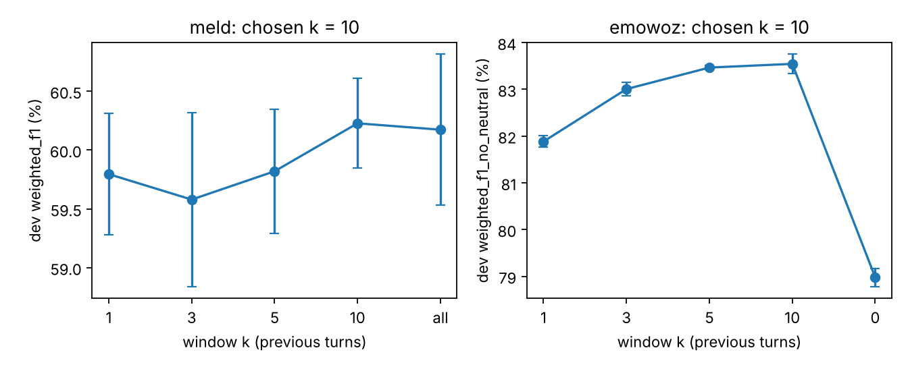
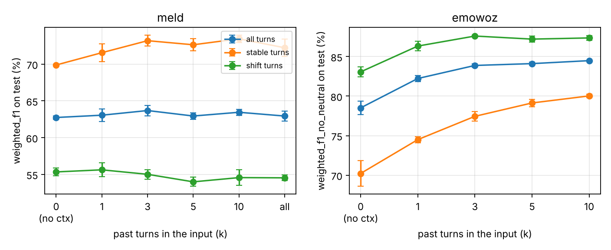
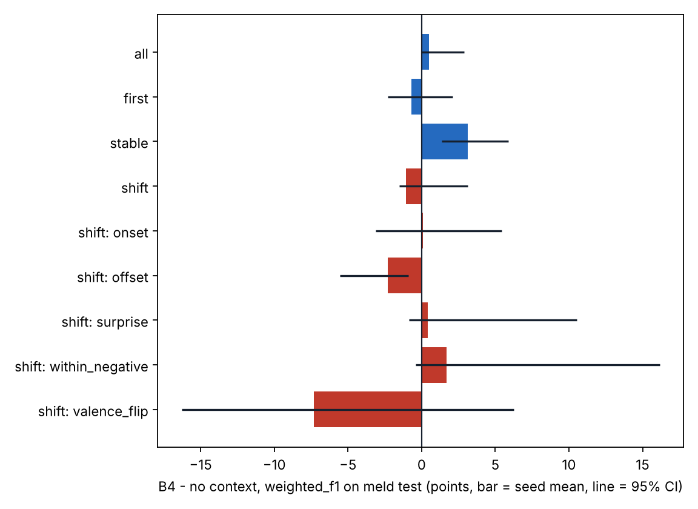
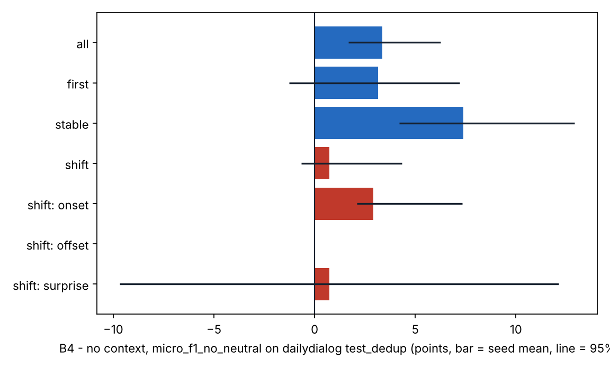
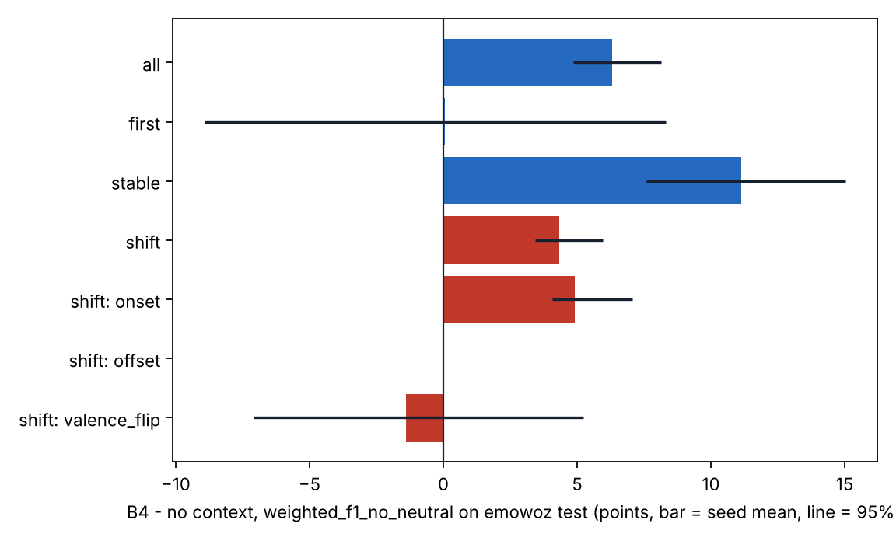
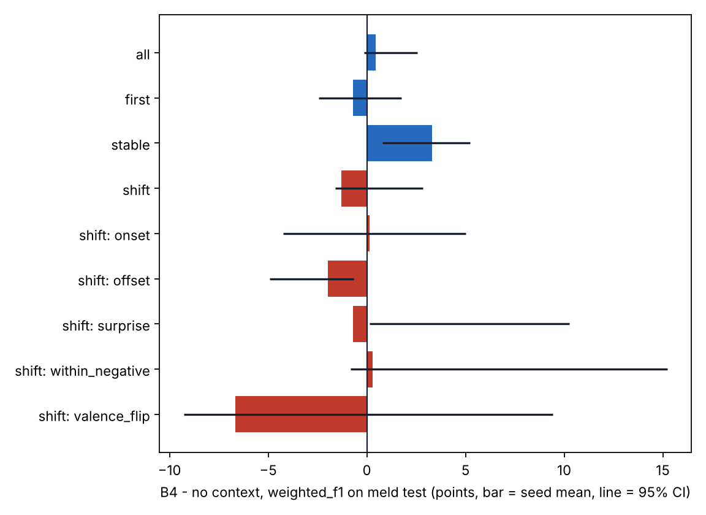
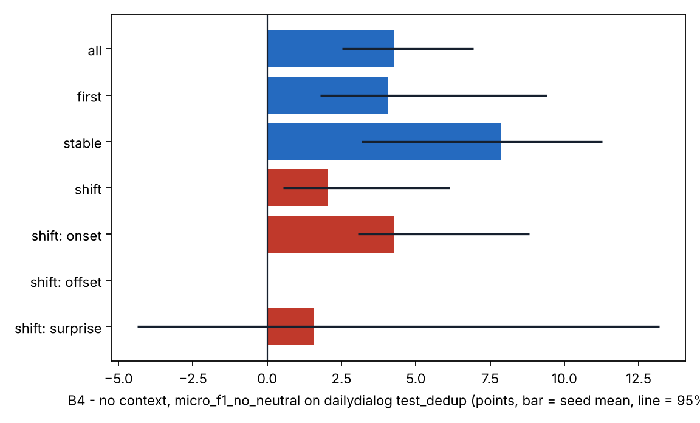
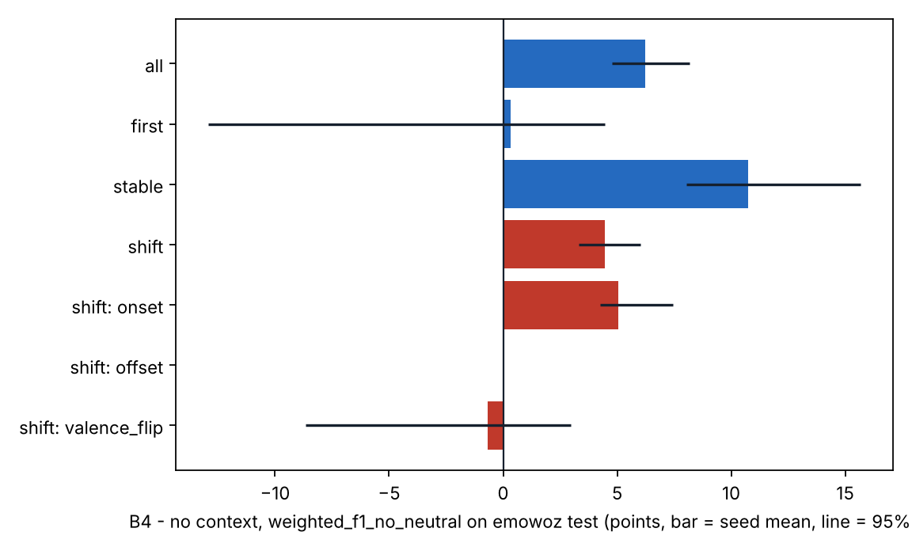

# B4 overall: chosen window and k = all

Part 1 is B4 at the window chosen on dev (tag `b4`), part 2 is the same model at k = all (tag `b4all`). Both use the same recipe, seeds and splits.

---

## Part 1: chosen window

Mean ± std over seeds, in %. roberta-base, lr 1e-05, batch 32, max_len 256, speaker names on, past turns only, history cut on the left.

## Test results

| Dataset | Test split | k | n | Headline | Weighted-F1 | Macro-F1 | Micro-F1 excl. neutral | Weighted-F1 excl. neutral | Derived shift F1 |
|---|---|---|---|---|---|---|---|---|---|
| meld | test | 10 | 2610 | weighted_f1 | 63.34 ± 0.41 | 40.55 ± 0.25 | 50.98 ± 0.50 | 48.21 ± 0.32 | 72.34 ± 1.06 |
| dailydialog | test_dedup | 10 | 7019 | micro_f1_no_neutral | 85.47 ± 0.13 | 45.49 ± 3.03 | 58.71 ± 0.46 | 56.90 ± 0.95 | 51.59 ± 0.72 |
| dailydialog | test | 10 | 7740 | micro_f1_no_neutral | 85.39 ± 0.12 | 47.13 ± 2.59 | 58.88 ± 0.35 | 57.41 ± 0.82 | 51.47 ± 0.85 |
| emowoz | test | 10 | 8634 | weighted_f1_no_neutral | 91.51 ± 0.05 | 60.38 ± 0.25 | 84.85 ± 0.15 | 84.38 ± 0.16 | 80.37 ± 0.24 |

## Window sweep (E3, dev only)

**meld** (dev weighted_f1, 3 sweep seeds, chosen k = 10):

| k | seeds | dev mean | dev std |
|---|---|---|---|
| 1 | 3 | 59.80 | 0.52 |
| 3 | 3 | 59.58 | 0.74 |
| 5 | 3 | 59.82 | 0.53 |
| 10 | 3 | 60.23 | 0.38 |
| all | 3 | 60.17 | 0.64 |

**dailydialog**: window taken from k_from:meld (k = 10).

**emowoz** (dev weighted_f1_no_neutral, 3 sweep seeds, chosen k = 10):

| k | seeds | dev mean | dev std |
|---|---|---|---|
| 1 | 3 | 81.88 | 0.12 |
| 3 | 3 | 83.01 | 0.14 |
| 5 | 3 | 83.47 | 0.04 |
| 10 | 3 | 83.55 | 0.21 |
| 0 | 5 | 78.98 | 0.20 |

## Window sweep on test, by stratum (E3)

**meld**, test weighted_f1 (%), mean ± SD over the sweep seeds (k = 0: no context):

| k | Seeds | All | First | Stable | Shift |
|---|---|---|---|---|---|
| 0 | 3 | 62.74 ± 0.23 | 65.42 ± 0.30 | 69.89 ± 0.12 | 55.34 ± 0.53 |
| 1 | 3 | 63.06 ± 0.85 | 63.99 ± 0.60 | 71.56 ± 1.20 | 55.62 ± 0.96 |
| 3 | 3 | 63.69 ± 0.72 | 65.14 ± 0.99 | 73.19 ± 0.74 | 55.01 ± 0.65 |
| 5 | 3 | 62.94 ± 0.43 | 64.60 ± 0.10 | 72.64 ± 0.83 | 53.99 ± 0.62 |
| 10 | 3 | 63.45 ± 0.42 | 64.72 ± 0.41 | 73.45 ± 0.52 | 54.56 ± 1.07 |
| all | 3 | 62.94 ± 0.69 | 64.25 ± 0.81 | 72.23 ± 1.18 | 54.53 ± 0.40 |

**emowoz**, test weighted_f1_no_neutral (%), mean ± SD over the sweep seeds (k = 0: no context):

| k | Seeds | All | First | Stable | Shift |
|---|---|---|---|---|---|
| 0 | 3 | 78.51 ± 0.84 | 56.91 ± 1.27 | 70.22 ± 1.64 | 83.07 ± 0.63 |
| 1 | 3 | 82.23 ± 0.37 | 58.52 ± 2.73 | 74.50 ± 0.39 | 86.33 ± 0.62 |
| 3 | 3 | 83.88 ± 0.21 | 57.12 ± 1.50 | 77.45 ± 0.60 | 87.60 ± 0.13 |
| 5 | 3 | 84.11 ± 0.19 | 57.77 ± 1.50 | 79.14 ± 0.47 | 87.21 ± 0.38 |
| 10 | 3 | 84.49 ± 0.05 | 59.00 ± 1.20 | 80.03 ± 0.23 | 87.36 ± 0.29 |

## Gain over no context (E2)

**meld**, test, weighted_f1 (%), b4 k=10 minus `b3`; CI = paired dialogue bootstrap on seed 0:

| Group | n | Reference | B4 | Delta | 95% CI |
|---|---|---|---|---|---|
| all | 2610 | 62.85 | 63.34 | +0.49 | [+0.0, +2.9] |
| stratum:first | 746 | 65.18 | 64.49 | -0.69 | [-2.3, +2.1] |
| stratum:stable | 861 | 69.73 | 72.85 | +3.12 | [+1.4, +5.9] |
| stratum:shift | 1003 | 55.91 | 54.86 | -1.05 | [-1.5, +3.1] |
| shift_type:onset | 355 | 50.25 | 50.35 | +0.10 | [-3.1, +5.4] |
| shift_type:offset | 340 | 91.81 | 89.51 | -2.30 | [-5.5, -0.9] |
| shift_type:surprise | 158 | 60.84 | 61.27 | +0.43 | [-0.9, +10.6] |
| shift_type:within_negative | 81 | 31.78 | 33.47 | +1.70 | [-0.4, +16.2] |
| shift_type:valence_flip | 69 | 57.77 | 50.45 | -7.31 | [-16.3, +6.3] |

**dailydialog**, test_dedup, micro_f1_no_neutral (%), b4 k=10 minus `b3`; CI = paired dialogue bootstrap on seed 0:

| Group | n | Reference | B4 | Delta | 95% CI |
|---|---|---|---|---|---|
| all | 7019 | 55.34 | 58.71 | +3.37 | [+1.7, +6.2] |
| stratum:first | 1782 | 52.67 | 55.83 | +3.16 | [-1.3, +7.2] |
| stratum:stable | 4295 | 37.89 | 45.27 | +7.38 | [+4.2, +12.9] |
| stratum:shift | 942 | 71.46 | 72.19 | +0.73 | [-0.7, +4.3] |
| shift_type:onset | 565 | 74.56 | 77.49 | +2.93 | [+2.1, +7.3] |
| shift_type:offset | 329 | 0.00 | 0.00 | +0.00 | [+0.0, +0.0] |
| shift_type:surprise | 38 | 59.43 | 60.17 | +0.74 | [-9.7, +12.1] |
| shift_type:within_negative | 4 | 48.14 | 30.48 | -17.67 | n < 30, not interpreted |
| shift_type:valence_flip | 6 | 50.00 | 45.71 | -4.29 | n < 30, not interpreted |

**emowoz**, test, weighted_f1_no_neutral (%), b4 k=10 minus `b3`; CI = paired dialogue bootstrap on seed 0:

| Group | n | Reference | B4 | Delta | 95% CI |
|---|---|---|---|---|---|
| all | 8634 | 78.09 | 84.38 | +6.30 | [+4.9, +8.1] |
| stratum:first | 1100 | 57.75 | 57.82 | +0.06 | [-8.9, +8.3] |
| stratum:stable | 4884 | 69.17 | 80.32 | +11.15 | [+7.6, +15.0] |
| stratum:shift | 2650 | 82.75 | 87.08 | +4.33 | [+3.4, +6.0] |
| shift_type:onset | 1728 | 85.57 | 90.50 | +4.93 | [+4.1, +7.1] |
| shift_type:offset | 765 | 0.00 | 0.00 | +0.00 | [+0.0, +0.0] |
| shift_type:within_negative | 23 | 23.78 | 31.55 | +7.77 | n < 30, not interpreted |
| shift_type:valence_flip | 112 | 82.20 | 80.79 | -1.40 | [-7.1, +5.2] |
| shift_type:within_positive | 22 | 73.43 | 70.54 | -2.88 | n < 30, not interpreted |

## By stratum and shift type

**meld**, test (mean over seeds, %):

| Group | n | Weighted-F1 | Macro-F1 | Micro-F1 excl. neutral |
|---|---|---|---|---|
| all | 2610 | 63.34 | 40.55 | 50.98 |
| stratum:first | 746 | 64.49 | 38.49 | 49.36 |
| stratum:stable | 861 | 72.85 | 41.91 | 54.36 |
| stratum:shift | 1003 | 54.86 | 39.26 | 50.13 |
| shift_type:offset | 340 | 89.51 | 12.79 | 0.00 |
| shift_type:onset | 355 | 50.35 | 30.91 | 53.25 |
| shift_type:surprise | 158 | 61.27 | 33.19 | 63.04 |
| shift_type:valence_flip | 69 | 50.45 | 20.80 | 47.80 |
| shift_type:within_negative | 81 | 33.47 | 11.64 | 34.89 |

**dailydialog**, test_dedup (mean over seeds, %):

| Group | n | Weighted-F1 | Macro-F1 | Micro-F1 excl. neutral |
|---|---|---|---|---|
| all | 7019 | 85.47 | 45.49 | 58.71 |
| stratum:first | 1782 | 88.41 | 48.49 | 55.83 |
| stratum:stable | 4295 | 88.92 | 37.40 | 45.27 |
| stratum:shift | 942 | 68.97 | 42.59 | 72.19 |
| shift_type:offset | 329 | 91.34 | 13.05 | 0.00 |
| shift_type:onset | 565 | 75.09 | 34.47 | 77.49 |
| shift_type:surprise | 38 | 57.33 | 29.01 | 60.17 |
| shift_type:valence_flip | 6 | 37.00 | 10.57 | 45.71 |
| shift_type:within_negative | 4 | 15.00 | 8.57 | 30.48 |

**emowoz**, test (mean over seeds, %):

| Group | n | Weighted-F1 | Macro-F1 | Micro-F1 excl. neutral |
|---|---|---|---|---|
| all | 8634 | 91.51 | 60.38 | 84.85 |
| stratum:first | 1100 | 97.18 | 28.11 | 56.98 |
| stratum:stable | 4884 | 93.98 | 38.52 | 79.27 |
| stratum:shift | 2650 | 85.51 | 60.22 | 87.87 |
| shift_type:offset | 765 | 94.54 | 13.51 | 0.00 |
| shift_type:onset | 1728 | 90.50 | 52.26 | 91.11 |
| shift_type:valence_flip | 112 | 80.79 | 37.72 | 82.47 |
| shift_type:within_negative | 23 | 31.55 | 21.74 | 46.77 |
| shift_type:within_positive | 22 | 70.54 | 15.39 | 70.74 |

## E4: input controls

**meld**, weighted_f1 (%), mean ± SD over 5 seeds, k = 10:

| Input | All | First | Stable | Shift |
|---|---|---|---|---|
| real | 63.34 ± 0.45 | 64.49 ± 0.43 | 72.85 ± 1.19 | 54.86 ± 0.89 |
| none | 62.11 ± 0.32 | 63.93 ± 0.50 | 69.57 ± 0.58 | 55.13 ± 0.80 |
| shuffled_context | 61.38 ± 0.52 | 63.65 ± 0.82 | 69.09 ± 0.75 | 53.86 ± 1.20 |
| shuffled_speakers | 63.25 ± 0.44 | 64.36 ± 0.18 | 72.59 ± 0.94 | 54.99 ± 1.11 |

**dailydialog**, micro_f1_no_neutral (%), mean ± SD over 5 seeds, k = 10:

| Input | All | First | Stable | Shift |
|---|---|---|---|---|
| real | 59.47 ± 0.70 | 57.48 ± 1.37 | 44.89 ± 0.71 | 73.81 ± 1.33 |
| none | 51.86 ± 0.67 | 51.97 ± 0.50 | 36.86 ± 0.79 | 64.92 ± 0.66 |
| shuffled_context | 50.06 ± 0.79 | 52.08 ± 1.53 | 30.95 ± 0.52 | 68.07 ± 0.70 |
| shuffled_speakers | 59.42 ± 0.68 | 57.39 ± 1.80 | 45.04 ± 0.69 | 73.62 ± 1.45 |

## Chosen window against b4all

Same model and recipe at the other window (headline metric per dataset, %).

| Dataset | Split | k (chosen) | Headline | k (other) | Headline | Other - chosen | 95% CI (seed 0) |
|---|---|---|---|---|---|---|---|
| meld | test | 10 | 63.34 ± 0.41 | all | 63.30 ± 0.42 | -0.04 | [-1.33, +0.58] |
| dailydialog | test_dedup | 10 | 58.71 ± 0.46 | all | 59.62 ± 0.82 | +0.92 | [-0.42, +1.91] |
| emowoz | test | 10 | 84.38 ± 0.16 | all | 84.31 ± 0.22 | -0.07 | [-0.44, +0.57] |

## R3: B4+ against B3

B4+ (class-weighted, k = 10) minus B3, MELD test macro-F1: **+3.21** points, 95% CI [+2.29, +7.17] (5 seeds, paired dialogue bootstrap).

| Model | Weighted-F1 | Macro-F1 | Micro-F1 excl. neutral |
|---|---|---|---|
| B4+ | 58.56 ± 0.41 | 43.77 ± 0.76 | 47.00 ± 0.81 |

## Efficiency (E9)

| Dataset | Parameters | Train time per seed | CPU latency per live step (median / p95) | Batch throughput |
|---|---|---|---|---|
| meld | 124.7 M | 1.5 min | 69.3 / 108.1 ms | 399 utt/s (cuda) |
| dailydialog | 124.7 M | 9.1 min | 63.2 / 113.4 ms | 357 utt/s (cuda) |
| emowoz | 124.7 M | 21.9 min | 67.0 / 96.1 ms | 233 utt/s (cuda) |

Training times depend on the GPU the run used (T4, L4 or A100); parameters and latency do not.

---

## Part 2: k = all

Mean ± std over seeds, in %. roberta-base, lr 1e-05, batch 32, max_len 256, speaker names on, past turns only, history cut on the left.

## Test results

| Dataset | Test split | k | n | Headline | Weighted-F1 | Macro-F1 | Micro-F1 excl. neutral | Weighted-F1 excl. neutral | Derived shift F1 |
|---|---|---|---|---|---|---|---|---|---|
| meld | test | all | 2610 | weighted_f1 | 63.30 ± 0.42 | 40.57 ± 0.53 | 51.03 ± 1.13 | 48.30 ± 0.92 | 71.87 ± 1.22 |
| dailydialog | test_dedup | all | 7019 | micro_f1_no_neutral | 85.72 ± 0.08 | 47.42 ± 1.84 | 59.62 ± 0.82 | 58.18 ± 0.77 | 52.90 ± 1.31 |
| dailydialog | test | all | 7740 | micro_f1_no_neutral | 85.64 ± 0.09 | 49.11 ± 1.77 | 59.77 ± 0.79 | 58.64 ± 0.76 | 52.75 ± 1.20 |
| emowoz | test | all | 8634 | weighted_f1_no_neutral | 91.44 ± 0.08 | 60.10 ± 0.30 | 84.73 ± 0.09 | 84.31 ± 0.22 | 80.07 ± 0.13 |

## Window sweep (E3, dev only)

**meld**: window taken from --k (final seeds retrained with --k) (k = all).

**dailydialog**: window taken from --k (final seeds retrained with --k) (k = all).

**emowoz**: window taken from --k (final seeds retrained with --k) (k = all).

## Gain over no context (E2)

**meld**, test, weighted_f1 (%), b4all k=all minus `b3`; CI = paired dialogue bootstrap on seed 0:

| Group | n | Reference | B4 | Delta | 95% CI |
|---|---|---|---|---|---|
| all | 2610 | 62.85 | 63.30 | +0.45 | [-0.1, +2.6] |
| stratum:first | 746 | 65.18 | 64.49 | -0.69 | [-2.4, +1.8] |
| stratum:stable | 861 | 69.73 | 73.04 | +3.31 | [+0.8, +5.2] |
| stratum:shift | 1003 | 55.91 | 54.61 | -1.30 | [-1.6, +2.9] |
| shift_type:onset | 355 | 50.25 | 50.37 | +0.13 | [-4.2, +5.0] |
| shift_type:offset | 340 | 91.81 | 89.82 | -1.99 | [-4.9, -0.7] |
| shift_type:surprise | 158 | 60.84 | 60.13 | -0.71 | [+0.1, +10.3] |
| shift_type:within_negative | 81 | 31.78 | 32.08 | +0.30 | [-0.8, +15.2] |
| shift_type:valence_flip | 69 | 57.77 | 51.10 | -6.67 | [-9.3, +9.4] |

**dailydialog**, test_dedup, micro_f1_no_neutral (%), b4all k=all minus `b3`; CI = paired dialogue bootstrap on seed 0:

| Group | n | Reference | B4 | Delta | 95% CI |
|---|---|---|---|---|---|
| all | 7019 | 55.34 | 59.62 | +4.29 | [+2.5, +6.9] |
| stratum:first | 1782 | 52.67 | 56.74 | +4.06 | [+1.8, +9.4] |
| stratum:stable | 4295 | 37.89 | 45.76 | +7.87 | [+3.2, +11.3] |
| stratum:shift | 942 | 71.46 | 73.50 | +2.04 | [+0.5, +6.1] |
| shift_type:onset | 565 | 74.56 | 78.84 | +4.28 | [+3.0, +8.8] |
| shift_type:offset | 329 | 0.00 | 0.00 | +0.00 | [+0.0, +0.0] |
| shift_type:surprise | 38 | 59.43 | 60.99 | +1.56 | [-4.4, +13.2] |
| shift_type:within_negative | 4 | 48.14 | 29.52 | -18.62 | n < 30, not interpreted |
| shift_type:valence_flip | 6 | 50.00 | 50.00 | +0.00 | n < 30, not interpreted |

**emowoz**, test, weighted_f1_no_neutral (%), b4all k=all minus `b3`; CI = paired dialogue bootstrap on seed 0:

| Group | n | Reference | B4 | Delta | 95% CI |
|---|---|---|---|---|---|
| all | 8634 | 78.09 | 84.31 | +6.23 | [+4.8, +8.2] |
| stratum:first | 1100 | 57.75 | 58.07 | +0.32 | [-12.9, +4.5] |
| stratum:stable | 4884 | 69.17 | 79.93 | +10.75 | [+8.0, +15.7] |
| stratum:shift | 2650 | 82.75 | 87.19 | +4.44 | [+3.3, +6.0] |
| shift_type:onset | 1728 | 85.57 | 90.61 | +5.04 | [+4.3, +7.5] |
| shift_type:offset | 765 | 0.00 | 0.00 | +0.00 | [+0.0, +0.0] |
| shift_type:within_negative | 23 | 23.78 | 30.07 | +6.29 | n < 30, not interpreted |
| shift_type:valence_flip | 112 | 82.20 | 81.53 | -0.67 | [-8.7, +3.0] |
| shift_type:within_positive | 22 | 73.43 | 72.60 | -0.83 | n < 30, not interpreted |

## By stratum and shift type

**meld**, test (mean over seeds, %):

| Group | n | Weighted-F1 | Macro-F1 | Micro-F1 excl. neutral |
|---|---|---|---|---|
| all | 2610 | 63.30 | 40.57 | 51.03 |
| stratum:first | 746 | 64.49 | 38.52 | 49.63 |
| stratum:stable | 861 | 73.04 | 42.29 | 54.82 |
| stratum:shift | 1003 | 54.61 | 39.07 | 49.83 |
| shift_type:offset | 340 | 89.82 | 12.83 | 0.00 |
| shift_type:onset | 355 | 50.37 | 31.00 | 53.21 |
| shift_type:surprise | 158 | 60.13 | 32.42 | 61.84 |
| shift_type:valence_flip | 69 | 51.10 | 20.85 | 49.09 |
| shift_type:within_negative | 81 | 32.08 | 11.10 | 33.43 |

**dailydialog**, test_dedup (mean over seeds, %):

| Group | n | Weighted-F1 | Macro-F1 | Micro-F1 excl. neutral |
|---|---|---|---|---|
| all | 7019 | 85.72 | 47.42 | 59.62 |
| stratum:first | 1782 | 88.50 | 49.25 | 56.74 |
| stratum:stable | 4295 | 88.92 | 38.29 | 45.76 |
| stratum:shift | 942 | 70.54 | 46.72 | 73.50 |
| shift_type:offset | 329 | 91.38 | 13.05 | 0.00 |
| shift_type:onset | 565 | 77.00 | 38.86 | 78.84 |
| shift_type:surprise | 38 | 57.28 | 29.29 | 60.99 |
| shift_type:valence_flip | 6 | 40.00 | 11.43 | 50.00 |
| shift_type:within_negative | 4 | 13.33 | 7.62 | 29.52 |

**emowoz**, test (mean over seeds, %):

| Group | n | Weighted-F1 | Macro-F1 | Micro-F1 excl. neutral |
|---|---|---|---|---|
| all | 8634 | 91.44 | 60.10 | 84.73 |
| stratum:first | 1100 | 97.10 | 26.97 | 56.42 |
| stratum:stable | 4884 | 93.80 | 38.37 | 78.78 |
| stratum:shift | 2650 | 85.67 | 60.49 | 87.98 |
| shift_type:offset | 765 | 94.52 | 13.50 | 0.00 |
| shift_type:onset | 1728 | 90.61 | 52.55 | 91.23 |
| shift_type:valence_flip | 112 | 81.53 | 38.44 | 82.90 |
| shift_type:within_negative | 23 | 30.07 | 20.31 | 44.74 |
| shift_type:within_positive | 22 | 72.60 | 16.50 | 71.10 |

## E4: input controls

**meld**, weighted_f1 (%), mean ± SD over 5 seeds, k = all:

| Input | All | First | Stable | Shift |
|---|---|---|---|---|
| real | 63.30 ± 0.47 | 64.49 ± 0.58 | 73.04 ± 0.37 | 54.61 ± 1.32 |
| none | 61.86 ± 0.59 | 63.62 ± 0.80 | 68.93 ± 0.63 | 55.26 ± 0.94 |
| shuffled_context | 61.32 ± 0.36 | 63.61 ± 0.69 | 68.73 ± 0.90 | 54.05 ± 1.39 |
| shuffled_speakers | 63.16 ± 0.43 | 64.54 ± 0.69 | 72.67 ± 0.38 | 54.59 ± 1.10 |

**dailydialog**, micro_f1_no_neutral (%), mean ± SD over 5 seeds, k = all:

| Input | All | First | Stable | Shift |
|---|---|---|---|---|
| real | 59.62 ± 0.92 | 56.74 ± 1.06 | 45.76 ± 0.83 | 73.50 ± 2.37 |
| none | 51.53 ± 0.92 | 51.34 ± 1.64 | 37.39 ± 1.14 | 63.97 ± 1.57 |
| shuffled_context | 49.27 ± 0.44 | 50.84 ± 1.81 | 30.77 ± 1.26 | 66.82 ± 1.85 |
| shuffled_speakers | 59.49 ± 0.76 | 57.08 ± 1.24 | 45.24 ± 0.81 | 73.53 ± 2.03 |

**emowoz**, weighted_f1_no_neutral (%), mean ± SD over 5 seeds, k = all:

| Input | All | First | Stable | Shift |
|---|---|---|---|---|
| real | 84.31 ± 0.25 | 58.07 ± 2.47 | 79.93 ± 0.86 | 87.19 ± 0.38 |
| none | 60.44 ± 1.08 | 54.25 ± 3.73 | 48.83 ± 0.53 | 65.28 ± 1.54 |
| shuffled_context | 70.44 ± 0.28 | 58.07 ± 2.47 | 53.71 ± 0.47 | 77.74 ± 0.52 |
| shuffled_speakers | 84.36 ± 0.28 | 57.88 ± 2.86 | 80.44 ± 0.73 | 86.98 ± 0.35 |

## R3: B4+ against B3

B4+ (class-weighted, k = all) minus B3, MELD test macro-F1: **+3.03** points, 95% CI [+1.65, +6.60] (5 seeds, paired dialogue bootstrap).

| Model | Weighted-F1 | Macro-F1 | Micro-F1 excl. neutral |
|---|---|---|---|
| B4+ | 58.24 ± 1.40 | 43.59 ± 0.83 | 46.66 ± 0.82 |

## Efficiency (E9)

| Dataset | Parameters | Train time per seed | CPU latency per live step (median / p95) | Batch throughput |
|---|---|---|---|---|
| meld | 124.7 M | 1.6 min | 67.8 / 118.7 ms | 349 utt/s (cuda) |
| dailydialog | 124.7 M | 9.1 min | 61.3 / 111.7 ms | 346 utt/s (cuda) |
| emowoz | 124.7 M | 9.6 min | 85.5 / 145.0 ms | 323 utt/s (cuda) |

Training times depend on the GPU the run used (T4, L4 or A100); parameters and latency do not.
